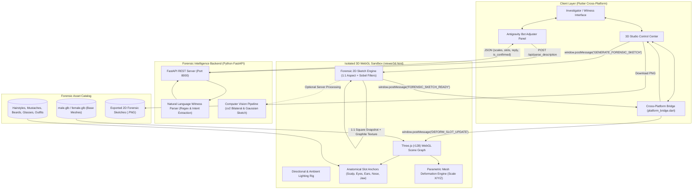

# NEURACRIME — SYSTEM ARCHITECTURE & TECHNICAL SPECIFICATION
**Autonomous AI Crime Scene 3D Forensic Facial Composite & 2D Sketch Studio**

---

## 1. Executive Summary
**NeuraCrime** is a hybrid forensic engineering platform that translates witness statements into interactive, anatomically calibrated 3D facial models and authentic 2D hand-drawn forensic composite sketches. It features a decoupled, cross-platform architecture combining a **Flutter frontend** (Web & Mobile), an **isolated Three.js (WebGL) 3D graphics sandbox**, and an **asynchronous Python FastAPI / OpenCV computer vision engine**.

---

## 2. Technology Stack & Languages

| Domain | Technology / Library | Version | Functional Role |
| :--- | :--- | :--- | :--- |
| **Client Core** | **Dart** / Flutter Web & Mobile | `^3.x` | Reactive UI, dynamic Antigravity bot layout adjuster, witness interview dialogs, state management, and platform abstraction. |
| **3D Rendering Engine** | **JavaScript (ES6+)** / Three.js | `r128` | WebGL 3D rendering, orbit camera controls, lighting setups, mesh morphing, raycasting, and anatomical slot anchoring. |
| **Backend & NLP** | **Python** / FastAPI & Uvicorn | `3.12+` / `0.110+` | Asynchronous REST endpoints, natural language witness testimony parsing, morph parameter extraction, and session handling. |
| **Computer Vision** | **OpenCV (`cv2`)** & **NumPy** | `4.9+` / `1.26+` | Server-side image filtering, bilateral smoothing, edge extraction, Gaussian blur, and contrast normalization. |
| **Markup & Framing** | **HTML5** | Modern | Web entry point, isolated iframe container (`viewer3d.html`), high-resolution hidden canvas for 2D sketch extraction. |
| **Styling & HUD** | **CSS3** | Modern | Cyber Hacker HUD overlays, animated scanlines, camera preset selectors, draggable hair badges, and theme variables. |
| **Cross-Platform Bridge** | Dart Conditional Compilation | `Dart 3` | Decoupled platform bridge (`if (dart.library.html)`) allowing clean compilation on Android/iOS without `dart:html` crashes. |
| **3D Asset Formats** | **glTF 2.0 / GLB** | Binary | Khronos Group binary 3D assets: male/female base heads, hairstyles, facial hair, glasses, hats, and outfits. |
| **Data Interchange** | **JSON / REST / postMessage** | Standard | Client-to-backend REST API payloads and bi-directional Flutter-to-Three.js event messaging. |

---

## 3. High-Level System Architecture Diagram



---

## 4. Subsystem Deep Dive

### 4.1. Witness AI & Chat Engine (Dart)
- **Natural Language Parsing**: Receives plain witness statements (e.g., *"His face was oval and he had a thick viking moustache with dark sunglasses"*).
- **Interactive Morph Translation**: Calls the FastAPI backend to calculate non-uniform scaling vectors:
  $$\text{Scale}_X, \text{Scale}_Y, \text{Scale}_Z$$
- **Antigravity Bot Layout Adjuster**: A smooth draggable splitter that allows the investigator to dynamically resize or completely collapse/expand the witness chat panel or the 3D viewport.

### 4.2. 3D WebGL Composite Engine (JavaScript / Three.js)
- **Zero-Flicker Multi-Slot Anchoring**: Positions and scales facial assets relative to pre-calibrated anatomical landmarks:
  - `scalp`: Positioned at $(0, 1.780, 0.055)$ for hairstyles and headwear.
  - `eyebrows` & `eyes`: Symmetrically spaced with optical alignment.
  - `glasses`: Positioned at $(0, 1.662, 0.152)$ with ear-stem alignment.
  - `moustache` & `beard`: Snapped to upper lip and mandible bones.
- **Parametric Deformation**: Transforms vertices of base glTF heads in real-time according to witness feedback without skeletal rigging overhead.

### 4.3. Instant 2D Forensic Sketch Engine
- **1:1 Square Orthogonal Camera Framing**: Locks the camera at portrait distance ($d = 0.88\text{m}$, $\text{FOV} = 38^\circ$) in a square viewport to completely eliminate wide-angle distortion and horizontal squishing.
- **Lighting & Silhouette Isolation**: Temporarily hides studio grids and substitutes background with pure white ($\text{RGB}(255, 255, 255)$) during snapshot capture.
- **Sobel Contour Detection & Graphite Tone Mapping**:
  Computes spatial gradients over luminance $L(x, y)$:
  $$G_x = \begin{bmatrix} -1 & 0 & +1 \\ -2 & 0 & +2 \\ -1 & 0 & +1 \end{bmatrix} * L, \quad G_y = \begin{bmatrix} -1 & -2 & -1 \\ 0 & 0 & 0 \\ +1 & +2 & +1 \end{bmatrix} * L$$
  $$E(x, y) = \sqrt{G_x^2 + G_y^2}$$
  Applies graphite grain noise and pencil stroke modulation to map midtones and dark shadows (hair, moustache, sunglasses) into authentic pencil linework.
- **Zero Artificial Vector Overlays**: Linework is 100% derived from the actual 3D model geometry.

### 4.4. Cross-Platform Architectural Bridge
To ensure the codebase runs seamlessly on **Chrome/Web**, **Android Phones**, and **Desktop**:
- `platform_bridge.dart` routes via Dart conditional export:
  - When compiling for Web (`dart.library.html`), compiles `platform_bridge_web.dart` (native `IFrameElement`, `window.postMessage`, `AnchorElement`).
  - When compiling for Android (`assembleDebug`), compiles `platform_bridge_stub.dart` with zero web dependencies, allowing the mobile APK to build and launch without compile errors.

---

## 5. Directory & Module Structure

```
neuracrime/
├── backend/                        # Python FastAPI Backend
│   ├── app.py                      # REST endpoints & OpenCV sketch logic
│   └── requirements.txt            # Python dependencies
├── lib/                            # Flutter Client Application
│   ├── models/                     # Data models (ChatMessage, ForensicAsset, CompositeParams)
│   ├── screens/                    # Application screens
│   │   ├── auth_screen.dart        # Cyber investigator login & personnel badge
│   │   ├── welcome_screen.dart     # Case directory & system launcher
│   │   └── witness_chat_screen.dart# Witness interview & Antigravity bot splitter
│   ├── services/                   # Service layer & cross-platform bridge
│   │   ├── api_service.dart        # HTTP client for Python backend
│   │   ├── platform_bridge.dart    # Conditional export dispatcher
│   │   ├── platform_bridge_stub.dart # Mobile/Android stub implementation
│   │   └── platform_bridge_web.dart  # Web IFrame & PostMessage implementation
│   ├── theme/                      # Visual identity & color palettes
│   │   └── app_theme.dart          # Obsidian Dark (#090D14) & Cyber Teal (#00BFA5)
│   ├── widgets/                    # Modular widgets
│   │   └── composite_3d_viewport.dart # 3D studio, tabs, sliders, & action bar
│   └── main.dart                   # Application entry point
└── web/                            # Web assets & 3D WebGL runtime
    ├── index.html                  # Flutter Web bootstrap
    ├── viewer3d.html               # Three.js 3D WebGL Studio & 2D Sketch engine
    ├── models/                     # Base 3D human head models (male.glb, female.glb)
    └── assets/                     # 3D slot assets (hair, beards, glasses, suits)
```

---

## 6. Execution & Deployment Guide

### Run Python Backend:
```bash
cd backend
python -m uvicorn app:app --host 127.0.0.1 --port 8000 --reload
```

### Run Flutter Web Studio:
```bash
flutter run -d chrome
```

### Run / Build Android Mobile Client:
```bash
flutter run
# Or build APK
flutter build apk --debug
```
